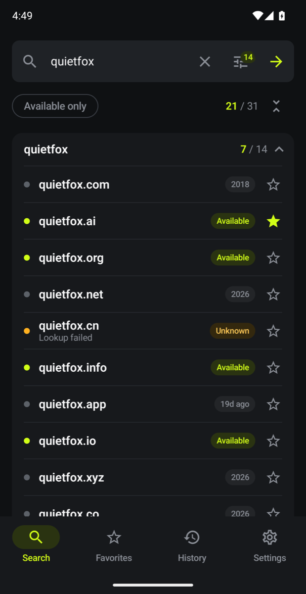
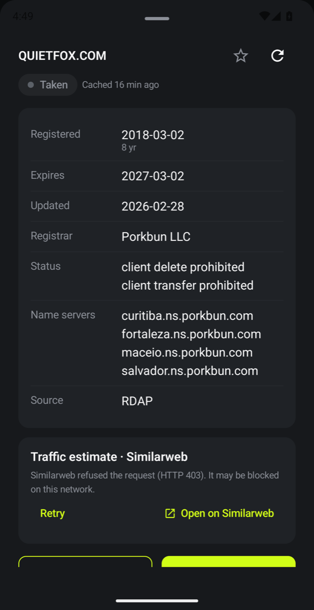
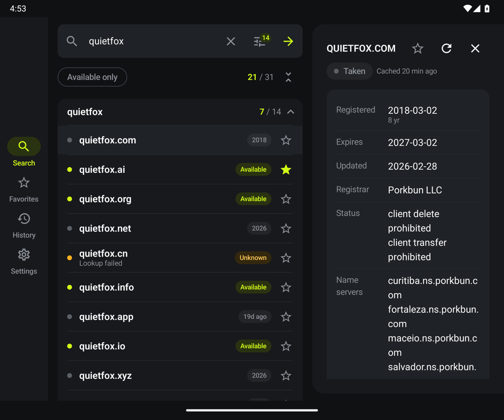
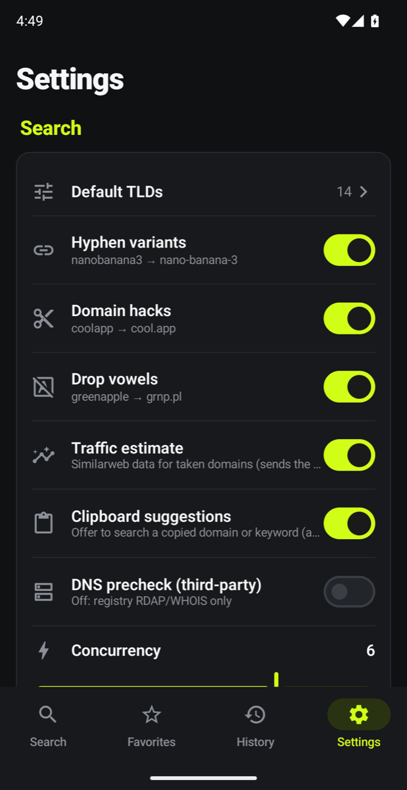
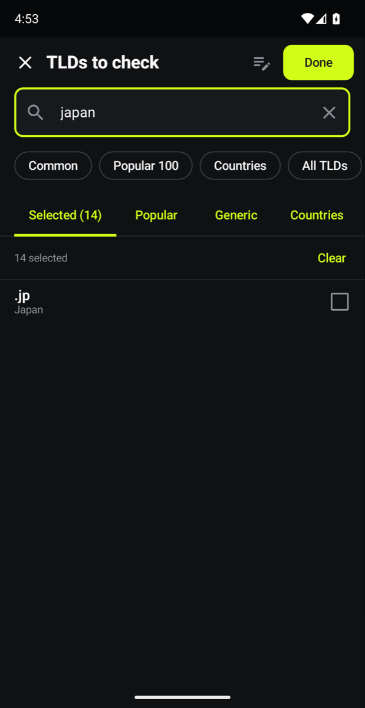

# DomainQ

**Check the availability of many domain names at once, straight from the registries, on your Android device.**

[**Download the latest APK**](https://github.com/seagen-lab/DomainQuery_Android/releases/latest)

- **Requirements:** Android 8.0 (API 26) or later
- **Package name:** `app.seagenlab.domainquery`
- **Price:** free, no account, no ads, no analytics

## Features

- **Bulk availability search.** Enter a keyword and check it against a set of TLDs, or paste several full domains separated by spaces, new lines or commas.
- **Every TLD.** All ~1,400 TLDs from the IANA root zone, plus second-level suffixes such as `com.cn` and `co.uk`, and internationalized domain names (IDN).
- **TLD presets.** Common, Popular, Countries and All. Pick TLDs with the tune icon inside the search box; the badge shows how many are selected.
- **Direct registry lookups.** Queries go to each registry's RDAP server (from the IANA bootstrap list), falling back to WHOIS on port 43. Requests are rate-limited per server.
- **Smart variants** (each can be turned off in Settings):
  - Hyphen variants: `nanobanana3` → `nano-banana-3`, `nano-banana3`, `nanobanana-3` (uses on-device English word segmentation)
  - Domain hacks: `coolapp` → `cool.app`, `coo.la`
  - Drop vowels: `greenapple` → `grnp.pl`
- **Organized results.** Grouped by name, collapsible, with "Collapse all / Expand all" and an "Available only" filter. Tags show the registration year (or "Nd ago"), For sale, expiry countdown, Restricted, and Unknown with a reason.
- **Domain details.** Registered, expiry and updated dates, registrar, status codes, name servers, and the raw RDAP/WHOIS response.
- **Traffic estimate.** For registered domains, an optional Similarweb estimate: monthly visits, global and country rank, bounce rate, pages per visit, average visit duration, traffic sources and top countries.
- **Register guide.** For available domains, quick links to Cloudflare, Spaceship, NameSilo, Namecheap and Porkbun, opened in an in-app half-screen browser.
- **Favorites, History and recent searches.** Rerun any previous query with one tap.
- **Adaptive layout.** Phone, landscape (navigation rail), and two-pane list + detail on foldables and tablets. Dark theme supported.
- **Languages.** English, French, Italian, German, Russian, Simplified Chinese, Traditional Chinese, Japanese and Korean.

## Screenshots

| Search | Detail |
| --- | --- |
|  |  |

| Foldable / tablet | Settings |
| --- | --- |
|  |  |



## Documentation

- [User Guide](docs/USER_GUIDE.md)
- [FAQ](docs/FAQ.md)
- [Privacy Policy](docs/PRIVACY.md)
- [Changelog](CHANGELOG.md)
- [License](LICENSE)

## Data sources & privacy

DomainQ has no account, no analytics and no ads. Your favorites, history and settings stay on your device.

The app contacts:

- **IANA**, to download the TLD list and the RDAP / WHOIS server directory.
- **Each TLD registry's RDAP or WHOIS server**, to look up the domains you search.
- **Similarweb** (optional, can be turned off), to fetch a traffic estimate for registered domains you open.
- **Public DNS resolvers** (Cloudflare, Google, AliDNS) only if you turn on "DNS precheck" (off by default).
- **Google Drive** only if you turn on sync; data goes to your own Drive app data folder.

See the full [Privacy Policy](docs/PRIVACY.md).

## Verifying the APK

The release APK is signed with this certificate (SHA-256):

```
6A:A0:A1:D4:15:6A:0F:7B:D6:B1:4B:AF:9A:8B:99:65:60:91:4A:B1:AF:C7:3D:02:99:A3:6A:0A:DA:6D:1D:7C
```

See [How do I verify the APK signature?](docs/FAQ.md#how-do-i-verify-the-apk-signature) for instructions.

## Source code

DomainQ is **not open source**. This repository contains only documentation and release downloads. See [LICENSE](LICENSE) for terms.

## Contact

Found a bug or have a suggestion? Please open an issue on [GitHub Issues](https://github.com/seagen-lab/DomainQuery_Android/issues).
